# Pipe Spawn and Scaffold Spawn (2026-11-01)

Astra, 2026-11-01: "Your pipe tool sucks. Fix it. Pipe spawn and scaffold spawn. Fix it. Make it better."

The pipe routes from 2026-10-31 were square and continuous, but they **floated**: only the yard runs had posts, and
everything else hung in the air. Small lines looked like wires on stilts, and the stairs were scaffold in name only.
Two new tools now build the supports and the scaffolds the way they are built on a real site, and each one checks its
own work against the rules it follows.

Model: `mini-model/the-cooling-tower-mini-model-20261030.html`. Written by Claude Opus 5.5 (`claude-opus-5-5`).

## Before and after

| Before | After |
|---|---|
| 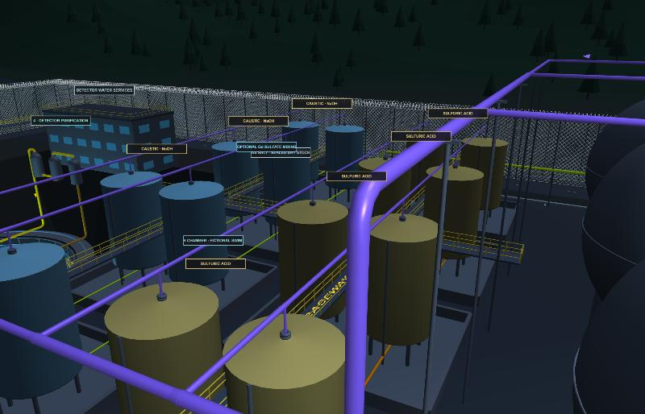 | 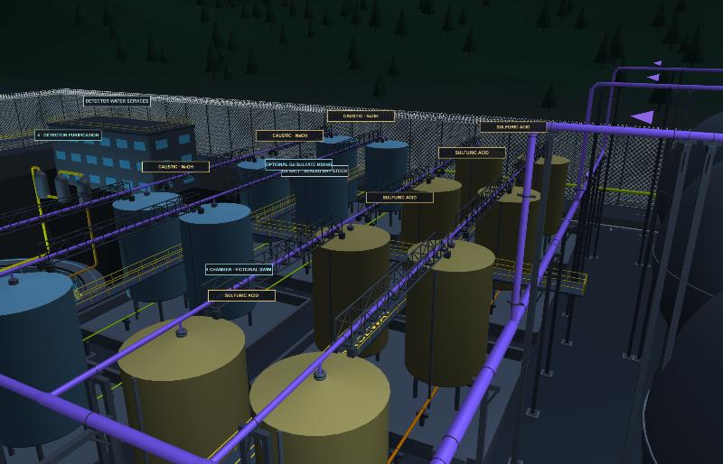 |
| 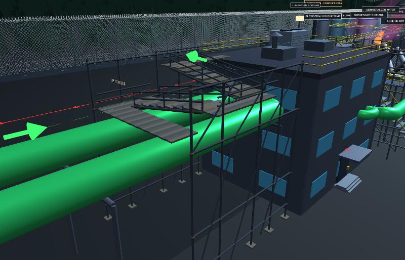 | 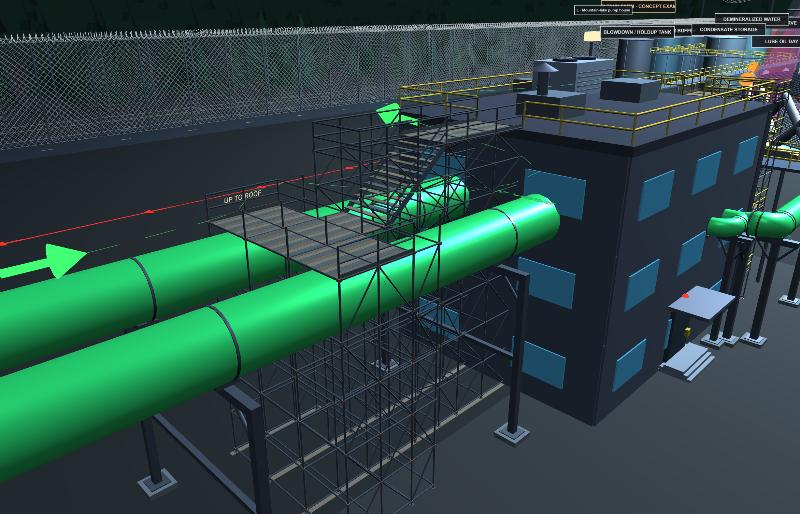 |
| 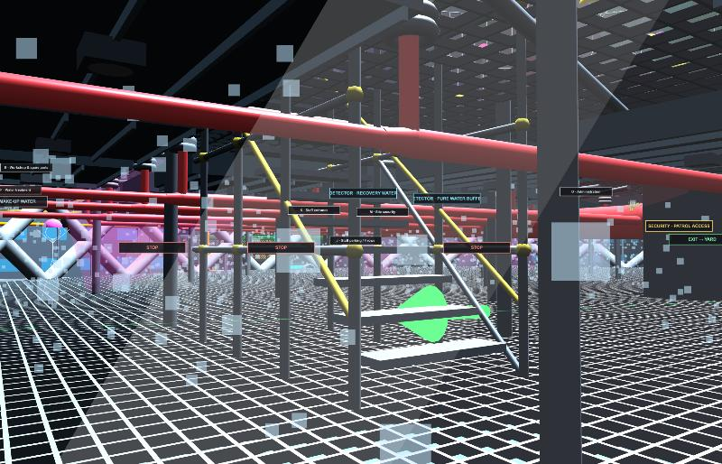 | 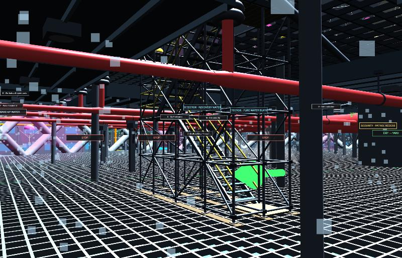 |
| 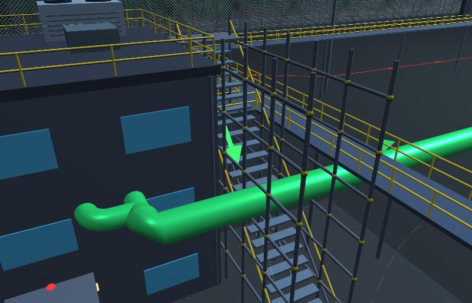 | 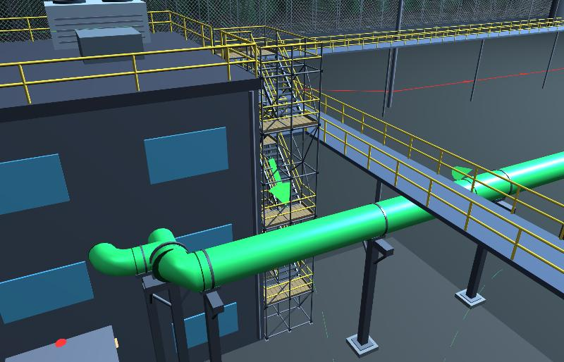 |

| Big lines in concrete saddles | Nitrogen spheres joined crown to crown |
|---|---|
| 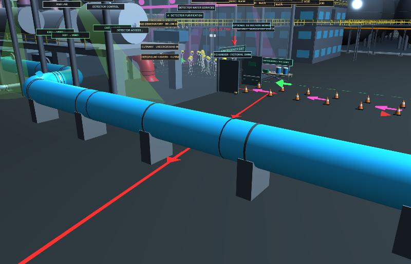 | 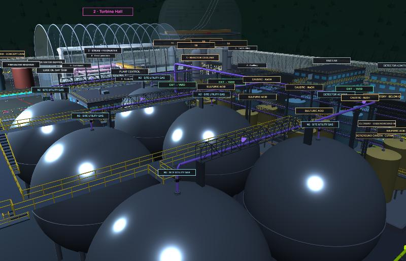 |

| | Before | After |
|---|---|---|
| Supports | 149 posts, yard runs only | 510: 199 T-posts, 18 shared rack bents, 76 hangers, 190 concrete saddles, 4 sleepers, 15 truss pipe bridges, 8 riser guides |
| Above-ground pipe more than half a span from a support (same 2,565 m, lake mains left out of both) | **848 m** (33 %) in 97 stretches | **11 m** in 6 short stretches |
| Lake mains | goalposts about 14 m apart (the span for a 2.1 m pipe is 9.1 m) | a concrete saddle every 7.7 m, bents where they climb to the pump house; with them counted, 12 m of 2,690 m is left |
| Stair rise | 0.5 m per step on all three scaffold stairs (stack, reactor hall, pump house) | 0.188–0.2 m on a 0.25 m going, 37–39° |
| Landings | none | one at every lift |
| Scaffold parts | posts, ledgers, a few braces | base plates, sole boards, standards, ledgers, transoms, kicker lifts, zig-zag face bracing, couplers, boarded decks, toe boards, guardrails and mid-rails, wall ties, a ladder |
| Pipe audit / Rail audit | pass / pass | pass / pass |
| Draw calls (whole plant) | 12,152 | 11,576 (supports and scaffolds are instanced) |

## pipe-spawn (`tools/pipe-spawn-20261101.js`)

Reads the same pipe record as the Pipe Continuity Auditor (`window.PIPE_NETWORK`) and places everything a pipe rests on:

- **Spacing.** The longest span for each pipe size follows ASME B31.1 Table 121.5 (water service; 2.1 m for 1 in up
  to 9.1 m for 24 in), kept at 85 % so supports of neighbouring lines can line up. There is a support beside every
  elbow; an equipment nozzle carries the pipe within 3.5 m of it.
- **The right support for the place.**
  - Big lines (⌀ 0.9 m and up) up to 4 m over the floor: **concrete saddles** with a steel strap.
  - Near the floor: **concrete sleepers** or **stub stands**, each with a pipe shoe and a U-bolt.
  - Inside buildings, under the cooling fill and under the operating floor: **hangers** from the steel overhead (a
    trapeze on two rods for bigger lines, a clevis rod for small ones).
  - Lines side by side in the yard: one **rack bent** (two columns, a beam per tier, knee braces) carries them all.
  - A lone line: a **T-post**, sized to the pipe.
  - Small elevated lines: posts no closer than a 6 m rack bay, with a **stringer** beam between them.
  - A line that runs just over raised surfaces (tank roofs, sphere crowns) and drops more than 3 m between them: a
    shared **truss pipe bridge** across each gap of up to 20 m.
  - Elevated lines crossing a road: a shared **girder road crossing** with an end frame on each side.
- **Clearance.** Every column, beam and rod is checked against buildings, equipment, stair towers and other pipes
  (round things as real cylinders). A support that cannot stand anywhere is listed, never forced through something.
- **Detail.** Footings and base plates under columns, shoes and U-bolts on every rest, riser guides every 6 m on tall
  verticals, a butt weld at both ends of every elbow and a girth weld every 12 m pipe length.

## scaffold-spawn (`tools/scaffold-spawn-20261101.js`)

- **Stair towers** (`stairTower`): switchback flights, one per lift, alternating lanes, with a landing at every lift.
  Rise at most 0.2 m on a 0.25 m going (EN 12811-1 access stairs; OSHA 1910.25 asks 0.15–0.19 m rise and at least
  0.24 m going), 30–50° (OSHA 1926.451(e)), no flight over 3.7 m without a landing, stair rails 0.9 m over the nosings
  on both sides (OSHA 1926.451(e)(4): 0.71–0.94 m). Options: an entry deck when the stair starts high up (from the pipe
  tops), an exit deck to a roof, exit at the end or to the side, one or two lanes, standards from a lower floor.
- **Access scaffolds** (`accessScaffold`): along a straight or curved wall, boarded at every lift, tied back to the
  wall (ties reach a wall that leans away, like the tower shell), with a ladder through traps in the first bay.
- **Both:** standards on base plates and sole boards, bays no longer than 2.6 m, ledgers and transoms at every lift
  and a kicker lift just over the ground, zig-zag face bracing in every bay, couplers at the joints, boarded decks with
  0.15 m toe boards, guardrails at 1.0 m with a mid-rail at 0.5 m on every open edge (EN 12811-1; OSHA 1926.451(g)(4)).
- **Fixed ladders** (`fixedLadder`): a permanent caged ladder bolted to a braced mast, for places people climb now and
  then (EN ISO 14122-4). Rungs 0.25–0.30 m apart, 0.4–0.6 m between the stiles, flights of at most 6 m staggered
  sideways with a rest landing between them, a cage from 2.2–3.0 m above each standing level with hoops no more than
  1.5 m apart and five straps, stiles 1.1 m above every landing and a self-closing gate at the top. Options: a truss
  walkway bridge straight on from the top, and a platform at its end with a hole for a nozzle. (OSHA 1910.28(b)(9)
  asks for a ladder safety system instead of a cage on new ladders over 24 ft; the cage is the EN arrangement.)
- `ScaffoldSpawn.check` re-measures what was built against those rules.

## Where they are used in the Mini Model

| Scaffold | What it is now |
|---|---|
| Stairs up to the dance floor (×2) | two-lift stair towers from the lower waffle grid up through new wells in the deck grating; the top landing opens north onto the deck; the crowd is kept out of the wells |
| Scaffold stairs up to the operating floor | a four-lift tower inside the hatch, up through a well cut in the operating floor ring; opens south onto the floor |
| Pump-house east roof-to-yard stairs | a six-lift tower against the east wall, clear of the Human Raceway bridge; the roof guardrail opens only where the top landing meets it |
| Makeshift crew scaffold | still salvaged (rusty clamps, mixed planks, grey tube rails) but put up properly: an entry deck resting on the two lake mains at 10 m, one flight, an exit deck onto the clubhouse roof |
| Maintenance scaffold on the inner shell | a 12 m access scaffold on the deck, boarded every 2 m, tied back to the leaning shell, ladder through traps |

Later the same day (Astra: the Horton spheres had "weird" walkways round them; the Human Raceway should only go between
them and a ladder is for reaching the top; all the other tanks need legs):

- The sphere crown stairs, crown walkway and crown platforms are gone. The Human Raceway runs only between the two
  sphere rows (x = 69).
- Each sphere has one caged ladder (`fixedLadder`): four 5.7 m flights with rest landings up a braced mast, then a
  9.9 m truss walkway bridge to a 3.2 m platform round the crown nozzle and its isolation valve. The west row climbs
  on the west side, away from the nitrogen header; the east row on the south side of each sphere, because the caustic
  transfer line runs along the north edge. The sphere legs now have concrete pads and crossed tie rods.
- Every other free-standing tank stands on legs: the eight utility tanks, the two detector water-service vessels,
  the Gd mixing tank and the three detector filters. Each has a dished bottom, legs on concrete pads with crossed
  bracing, and a valved bottom outlet that leaves between two legs. The lift is 1.4 m + 0.18 × radius, so the valve
  has at least 0.5 m of drop under the bottom. (Big atmospheric tanks usually sit on a ring wall rather than legs; legs
  here are by request.)

Pipe changes made for the supports: the nitrogen trunk now drops to tank-roof height (15 m) at the sphere rows instead of
running 68 m at 26 m on tall posts, and the blanketing headers sit on the tank roofs at 15 m (was 16 m).

## How to use them

- **In the Mini Model:** Map controls → Audits → **Support audit** and **Scaffold audit** (tap a line to fly there).
  Show / hide → **Pipe supports** hides the supports to see the pipes alone.
- **On their own:** [`tools/pipe-and-scaffold-spawn-panel-20261101.html`](../tools/pipe-and-scaffold-spawn-panel-20261101.html)
  — a yard rack crossing a road, a tank-farm header, lines in a building; a stair tower or access scaffold of any height.
  Change a slider and the tool rebuilds and checks itself.

  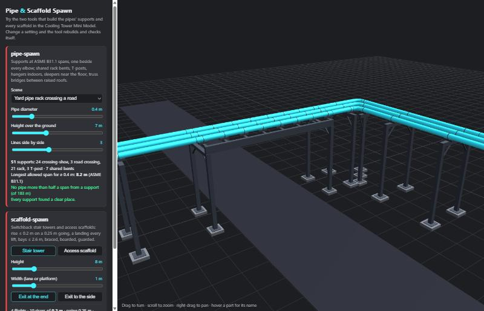
- **In code** (browser or Node, no dependencies for planning):
  `PipeSpawn.plan(runs, env)` → parts, supports, problems; `PipeSpawn.check(runs, plan, env)` → unsupported metres;
  `ScaffoldSpawn.stairTower({...})` / `accessScaffold({...})` → parts and a record; `ScaffoldSpawn.check(record)`;
  `PipeSpawn.build` / `ScaffoldSpawn.build(THREE, parts, materials, group)` → instanced three.js meshes.

## Honest limits

- Spans and sizes are rules of thumb for a believable model, not a stress or pipe-flexibility analysis; no loads,
  thermal expansion or anchors are calculated.
- 11 m of pipe is still more than half a span from a support, in six short stretches: next to the sphere-row tie-ins
  over the nitrogen trunk (2.5 m each) and beside two condenser hotwells, where equipment leaves no room for a post.
- Hangers in the turbine hall reach up to about 21 m to the roof steel; a real hall would add intermediate steel.
- The tools only know the obstacles the page registers; a column can still touch something that is drawn but not
  registered (trees, fences, small props).
- The Unity version (Pipe Spawner and Scaffold Spawner in the tools plan) is not built; these JavaScript tools give it
  the rules and the part lists to start from.
